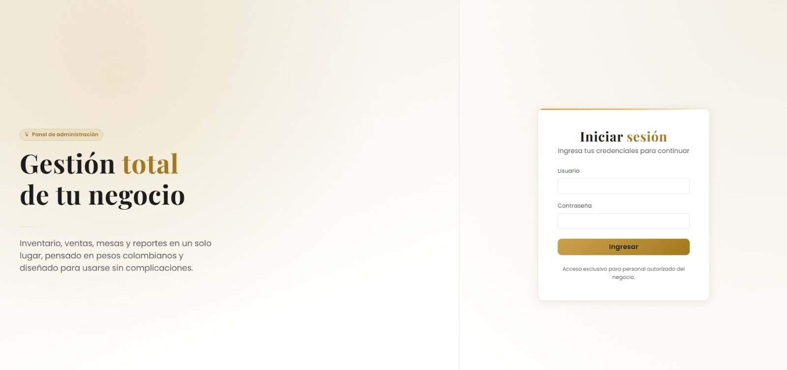
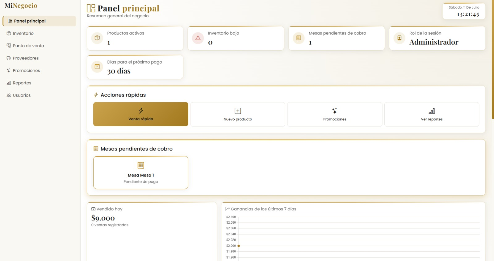
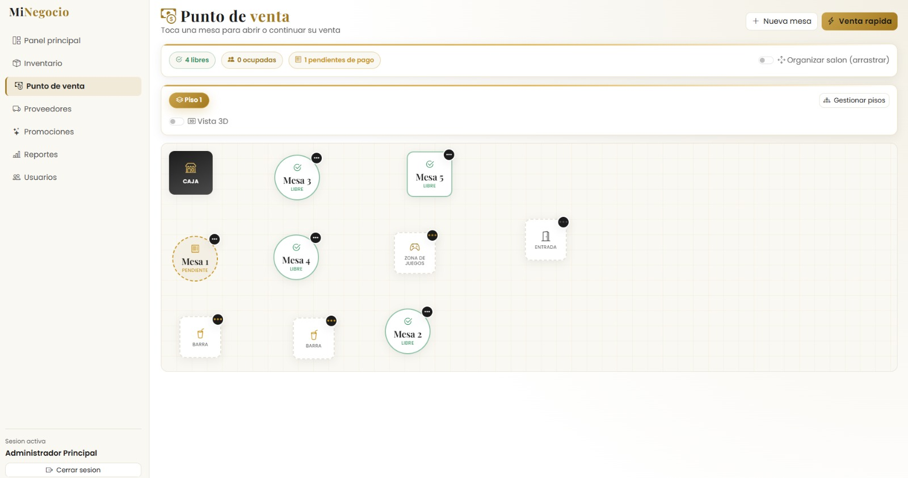
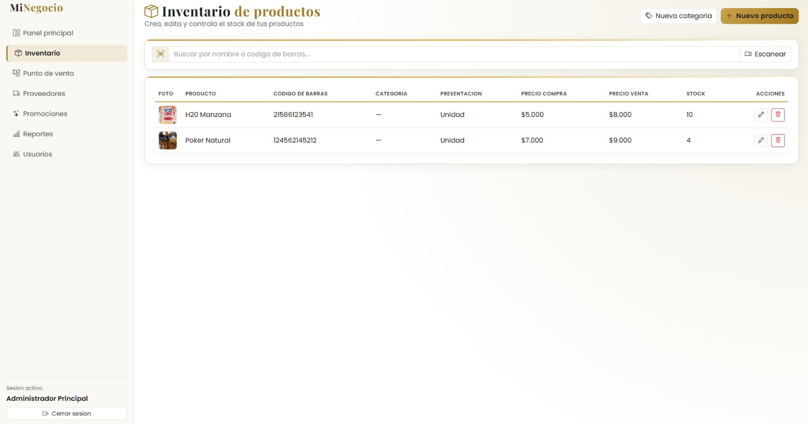
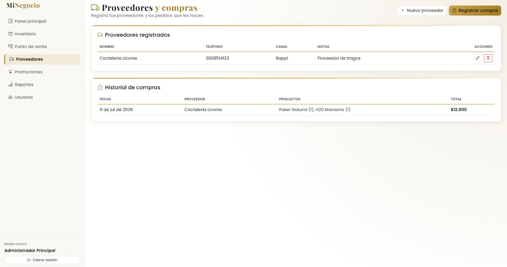
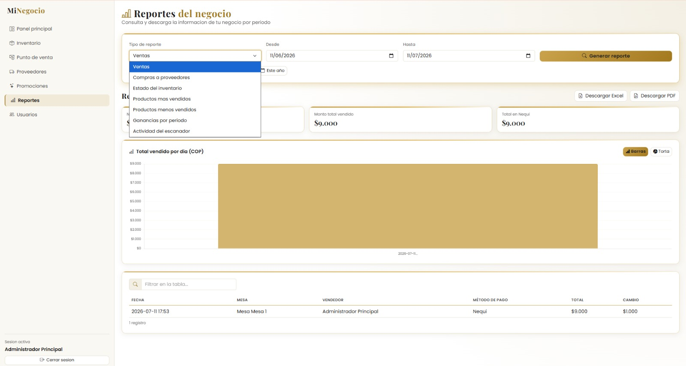

<!-- Ruta: README.md -->

<div align="center">

# 🥂 POST LEGACY

**Sistema de Gestión Integral de Negocios**
*Desarrollado por **SoftLegacy***

**Backend en FastAPI · Frontend en HTML, CSS, Bootstrap y JavaScript**

*Control total de inventario, ventas, compras, proveedores, promociones, usuarios y reportes — en un solo sistema elegante, seguro y en pesos colombianos (COP).*


</div>

---

## 📜 Tabla de contenidos

- [✨ ¿Qué es POST LEGACY?](#-qué-es-post-legacy)
- [🖼️ Capturas de pantalla](#️-capturas-de-pantalla)
- [🚀 Características principales](#-características-principales)
- [📂 Estructura del proyecto](#-estructura-del-proyecto)
- [⚙️ Instalación y ejecución](#️-instalación-y-ejecución)
  - [🐳 Opción 1: Con Docker (recomendado)](#-opción-1-con-docker-recomendado)
  - [💻 Opción 2: Instalación manual](#-opción-2-instalación-manual)
  - [🖱️ Opción 3: Accesos rápidos por sistema operativo](#️-opción-3-accesos-rápidos-por-sistema-operativo)
- [🔒 Módulo de suscripción y bloqueo mensual](#-módulo-de-suscripción-y-bloqueo-mensual)
- [👥 Roles de usuario](#-roles-de-usuario)
- [📊 Reportes y exportación](#-reportes-y-exportación)
- [❓ Preguntas frecuentes](#-preguntas-frecuentes)
- [📄 Licencia y términos de uso](#-licencia-y-términos-de-uso)
- [🏢 Sobre SoftLegacy](#-sobre-softlegacy)

---

## ✨ ¿Qué es POST LEGACY?

**POST LEGACY** es una plataforma de gestión empresarial completa desarrollada por **SoftLegacy**: controla **inventario, ventas, compras a proveedores, promociones, usuarios, reportes, analisis financiero y auditoría** desde un único panel elegante en tonos dorado y blanco.

No está atado a un solo tipo de negocio: sirve igual para un **restaurante, bar, tienda, minimarket, cafetería o cualquier negocio con manejo de productos y ventas**. El módulo de mesas y el escáner de códigos de barras son opcionales según el tipo de operación.

Todos los valores monetarios del sistema se manejan en **pesos colombianos (COP)**.

---

## 🖼️ Capturas de pantalla

<div align="center">

### 🔐 Inicio de sesión


### 📊 Panel principal (Dashboard)


### 🧾 Punto de venta (POS)


### 📦 Inventario


### 🛒 Compras y proveedores


### 📈 Reportes


</div>

---

### 1️⃣ Recorrido general del sistema
[](https://youtu.be/TU-ENLACE-VIDEO-1)

*👆 Presentación general: inicio de sesión, dashboard y navegación.*

### 2️⃣ Punto de venta y escáner de códigos de barras
[](https://youtu.be/TU-ENLACE-VIDEO-2)

*👆 Flujo completo de una venta, uso del escáner y manejo de mesas.*

### 3️⃣ Inventario, compras y reportes
[](https://youtu.be/TU-ENLACE-VIDEO-3)

*👆 Gestión de productos, compras a proveedores y exportación de reportes en Excel/PDF.*

</div>

---

## 🚀 Características principales

### 🧾 Punto de venta (POS)
- Registro de ventas en tiempo real, con manejo de mesas.
- Escáner de códigos de barras para agilizar la venta.

### 📦 Inventario y productos
- Alta, edición y baja de productos con imágenes (con validación real del archivo, no solo por extensión).
- Control de stock mínimo y alertas de reabastecimiento.
- Categorías de productos.

### 🛒 Compras y proveedores
- Registro de compras a proveedores.
- Historial de proveedores y sus productos.

### 🏷️ Promociones
- Creación de promociones y descuentos aplicables en el punto de venta.

### 📊 Reportes
- Exportación de reportes en **Excel** (openpyxl) y **PDF** (reportlab).
- Generación de reportes personalizados a partir de la información del negocio.

### 👥 Usuarios y roles
- Roles diferenciados (Administrador / Empleado) con permisos distintos por endpoint.

### 🔍 Escáner de códigos de barras
- Búsqueda instantánea de productos por código.
- Bitácora de auditoría de cada escaneo (sin exponer códigos en texto plano en los logs).

### 🔒 Suscripción y bloqueo automático
- Control de pago mensual con bloqueo automático del sistema si vence.
- Desbloqueo mediante clave maestra, protegido contra fuerza bruta.

### 🗂️ Monitoreo interno (logs)
- Registro de accesos, eventos de seguridad, errores y estado del sistema.
- Panel exclusivo para administradores, protegido con una clave adicional independiente de la contraseña de usuario.


---

## 📂 Estructura del proyecto

```
├── backend/                  # API en FastAPI
│   ├── app/
│   │   ├── models/           # Modelos de base de datos (SQLAlchemy)
│   │   ├── routers/          # Endpoints de la API
│   │   ├── schemas/          # Esquemas de validación (Pydantic)
│   │   ├── logs/             # Módulo de monitoreo interno
│   │   ├── suscripcion/      # Módulo de suscripción y bloqueo mensual
│   │   └── utils/            # Utilidades (exportar Excel/PDF, imágenes, etc.)
│   ├── escaner/               # Módulo de escáner de códigos de barras
│   ├── scripts/               # Scripts de mantenimiento (ver sección dedicada)
│   └── uploads/productos/     # Imágenes de productos
├── docker/                    # Dockerfiles y docker-compose.yml
├── docs/                      # 📸 Capturas de pantalla y 🎬 video (agrégalos aquí)
│   ├── images/
│   └── video/
├── execution/                 # Scripts de acceso rápido (Windows / Mac / Linux)
└── frontend/                  # HTML, CSS y JS del panel de administración
```

---

## ⚙️ Instalación y ejecución

### 🐳 Opción 1: Con Docker (recomendado)

**Requisitos:** Docker y Docker Compose instalados.

```bash
# 1. Clona el repositorio
git clone https://github.com/tu-usuario/tu-repositorio.git
cd tu-repositorio

# 2. Copia el archivo de configuración de ejemplo
cp backend/.env.example backend/.env

# 3. Edita backend/.env con tus propios valores (ver sección de configuración)

# 4. Levanta los contenedores
cd docker
docker compose up -d --build
```

El sistema quedará disponible en:

- 🌐 **Frontend (HTTPS):** `https://<IP-DEL-SERVIDOR>:5443`
- 📘 **Documentación interactiva de la API:** `https://<IP-DEL-SERVIDOR>:5443/docs`

> ⚠️ El certificado HTTPS es autofirmado: el navegador mostrará una advertencia la primera vez. Es normal en un entorno de red local; acéptala para continuar.

---

### 💻 Opción 2: Instalación manual

**Requisitos:** Python 3.11+ y un navegador moderno.

```bash
# 1. Ubícate en la carpeta del backend
cd backend

# 2. Crea y activa un entorno virtual
python -m venv venv
source venv/bin/activate      # En Windows: venv\Scripts\activate

# 3. Instala las dependencias
pip install -r requirements.txt

# 4. Copia y configura las variables de entorno
cp .env.example .env
# Edita el archivo .env con tus propios valores

# 5. Ejecuta el servidor
uvicorn app.main:app --reload --host 0.0.0.0 --port 8000
```

La API quedará disponible en `http://localhost:8000` y su documentación interactiva en `http://localhost:8000/docs`.

Para el **frontend**, basta con abrir los archivos `.html` de la carpeta `frontend/` en el navegador, o servirlos con cualquier servidor estático (por ejemplo, la extensión "Live Server" o `python -m http.server` dentro de la carpeta `frontend/`).

---

### 🖱️ Opción 3: Accesos rápidos por sistema operativo

La carpeta `execution/` incluye scripts listos para instalar, validar y abrir el sistema sin usar la terminal manualmente:

| Sistema operativo | Instalar | Abrir el sistema | Validar instalación |
|---|---|---|---|
| 🐧 Linux | `execution/linux/instalar.sh` | `execution/linux/abrir_sistema.sh` | `execution/linux/validar_sistema.sh` |
| 🍎 macOS | `execution/mac/instalar.command` | `execution/mac/abrir_sistema.command` | `execution/mac/validar_sistema.command` |
| 🪟 Windows | `execution/windows/instalar.bat` | `execution/windows/abrir_sistema.bat` | `execution/windows/validar_sistema.bat` |

En Windows también puedes generar un acceso directo en el escritorio ejecutando `execution/windows/crear_acceso_directo.vbs`.


## 🔒 Módulo de suscripción y bloqueo mensual

POST LEGACY incluye un control de pago mensual integrado:

- Cada ciclo dura los días definidos en `DIAS_SUSCRIPCION`.
- Cuando el ciclo vence, **toda la API se bloquea automáticamente** (código HTTP `423`), excepto el inicio de sesión y la propia pantalla de estado de la suscripción.
- Un administrador puede **renovar el ciclo por un mes más** ingresando la `CLAVE_MAESTRA_DESBLOQUEO`.
- Tras varios intentos fallidos consecutivos, el desbloqueo se bloquea temporalmente (protección contra fuerza bruta), independientemente del límite de peticiones por minuto ya existente.
- El valor de la suscripción (`VALOR_SUSCRIPCION_MENSUAL`) se muestra siempre en **pesos colombianos (COP)**.

---

## 👥 Roles de usuario

| Rol | Permisos |
|---|---|
| 🛡️ **Administrador** | Acceso total: usuarios, reportes, configuración de suscripción y panel de logs. |
| 🧑‍💼 **Empleado** | Acceso operativo: punto de venta, escáner, inventario y compras (según lo habilitado por el administrador). |

---

## 📊 Reportes y exportación

El módulo de reportes permite generar y descargar información del negocio en dos formatos:

- 📗 **Excel** (`.xlsx`) — ideal para análisis y manipulación de datos.
- 📕 **PDF** — ideal para impresión y entrega formal.

Todos los valores monetarios de los reportes se presentan en **pesos colombianos (COP)**.


## ❓ Preguntas frecuentes

**¿Puedo usar el sistema para cualquier tipo de negocio?**
Sí. El módulo de mesas y el escáner son opcionales; puedes usar solo inventario, ventas y reportes si tu negocio no requiere gestión de mesas.

**¿Qué pasa si no pago la suscripción a tiempo?**
El sistema se bloquea automáticamente hasta que un administrador lo desbloquee con la clave maestra.

**¿Los datos financieros están en otra moneda?**
No, todo el sistema trabaja en **pesos colombianos (COP)**.

---

## 📄 Licencia y términos de uso

**© SoftLegacy. Todos los derechos reservados.**

**POST LEGACY** es un software **propietario y de uso privado**. El código fuente, el diseño, la documentación, las imágenes y los videos contenidos en este repositorio son propiedad exclusiva de **SoftLegacy**, salvo que se indique expresamente lo contrario.

### ✅ Uso permitido

- Utilizar el sistema para la operación interna del negocio que adquirió o contrató la licencia.
- Realizar copias de seguridad de la base de datos e imágenes para uso interno.
- Modificar la configuración (`.env`) y los datos propios almacenados en el sistema.

### 🚫 Uso NO permitido

Queda estrictamente prohibido, salvo autorización previa y por escrito de SoftLegacy:

- Copiar, distribuir, sublicenciar, vender o revender el software (total o parcialmente) a terceros.
- Realizar ingeniería inversa, descompilar o intentar extraer el código fuente más allá de lo aquí publicado.
- Eliminar, ocultar u modificar los avisos de autoría, marca o licencia presentes en el sistema.
- Utilizar el nombre **POST LEGACY** o **SoftLegacy**, su identidad visual (paleta dorado/blanco, logotipos) o cualquier material de este repositorio para fines distintos a la operación autorizada del sistema.
- Usar el sistema para almacenar o procesar información obtenida de forma ilícita, o para fines contrarios a la ley colombiana o del país donde se opere.

### ⚠️ Garantía y responsabilidad

El software se entrega **"tal cual"**, sin garantías explícitas o implícitas de funcionamiento ininterrumpido o libre de errores. SoftLegacy no se hace responsable por:

- Pérdidas de información derivadas de un mal uso, falta de copias de seguridad o modificaciones no autorizadas al código.
- Daños indirectos derivados del uso del sistema fuera de los términos aquí descritos.
- El uso del módulo de suscripción y bloqueo mensual es una funcionalidad contractual: su activación, desactivación o modificación debe acordarse directamente con SoftLegacy.

### 🔄 Actualizaciones

SoftLegacy podrá publicar actualizaciones, mejoras o parches de seguridad sobre este sistema. El uso continuado del software implica la aceptación de los presentes términos y de sus futuras actualizaciones razonables.

### 📬 Soporte y contacto

Para soporte técnico, renovación de suscripción, dudas sobre la licencia o solicitud de nuevas funcionalidades, comunícate directamente con **SoftLegacy** a través de los canales oficiales entregados al momento de la contratación.

---

## 🏢 Sobre SoftLegacy

**SoftLegacy** es la empresa desarrolladora de **POST LEGACY**, un sistema de gestión empresarial pensado para negocios que buscan control, seguridad y una experiencia visual elegante en un solo lugar.

<div align="center">

**🥂 POST LEGACY — Hecho con dedicación, seguridad y buen gusto por el detalle.**
*Una creación de SoftLegacy.*

</div>